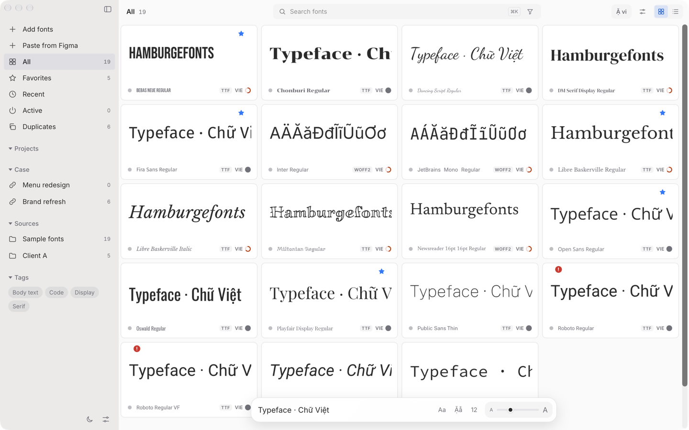
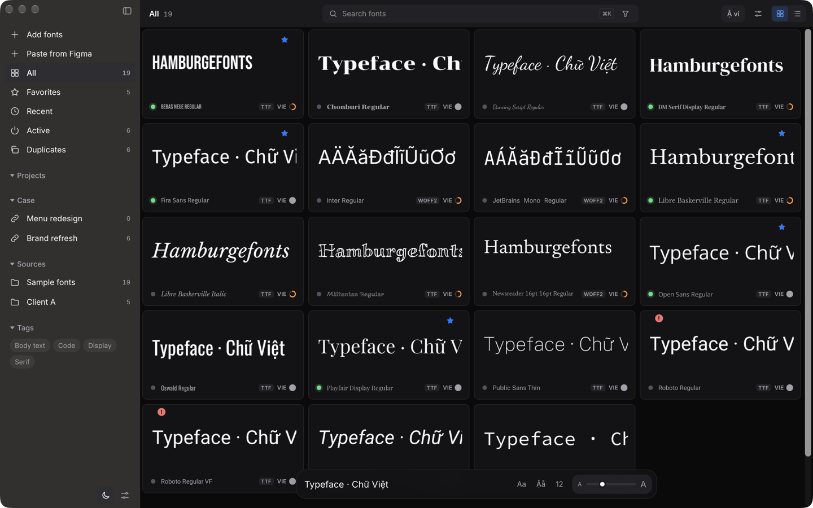
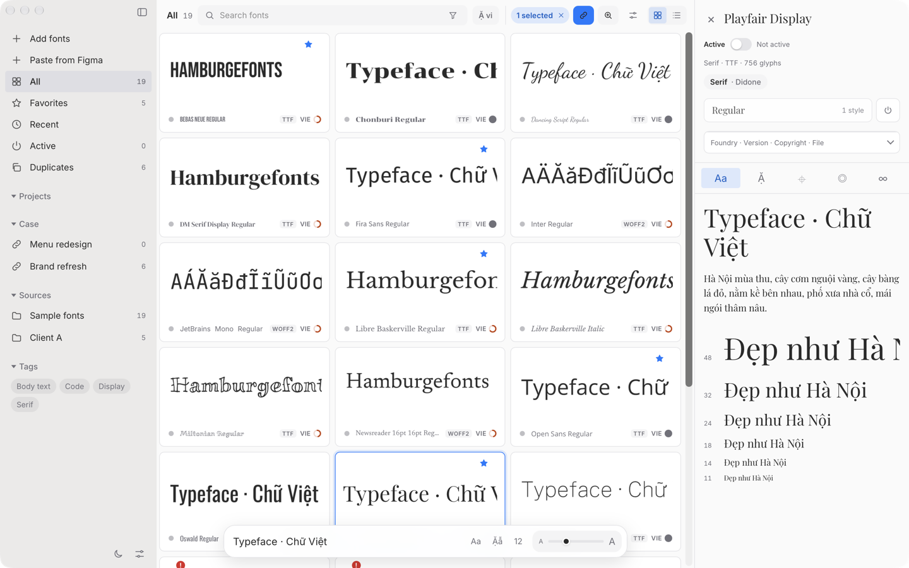
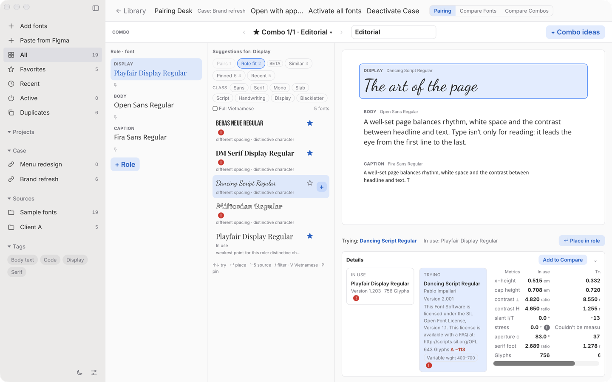
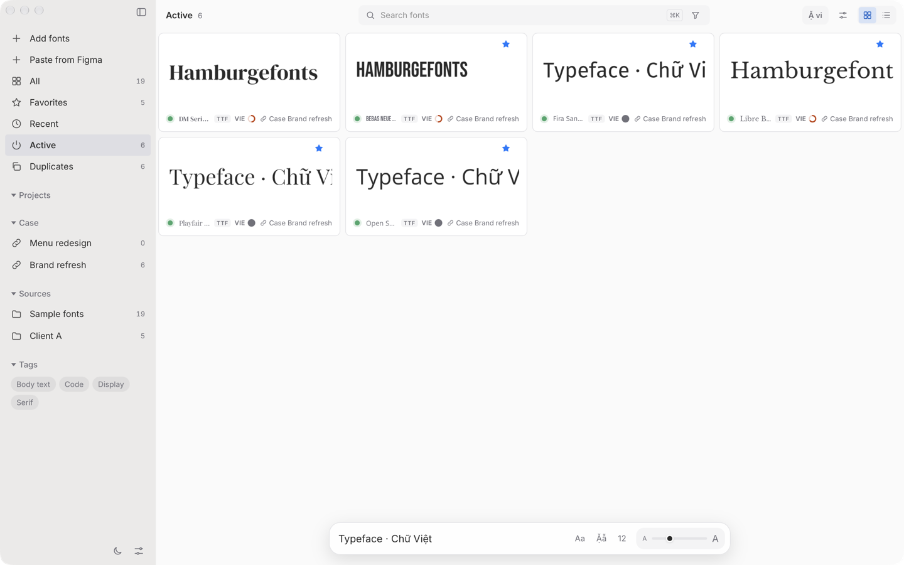
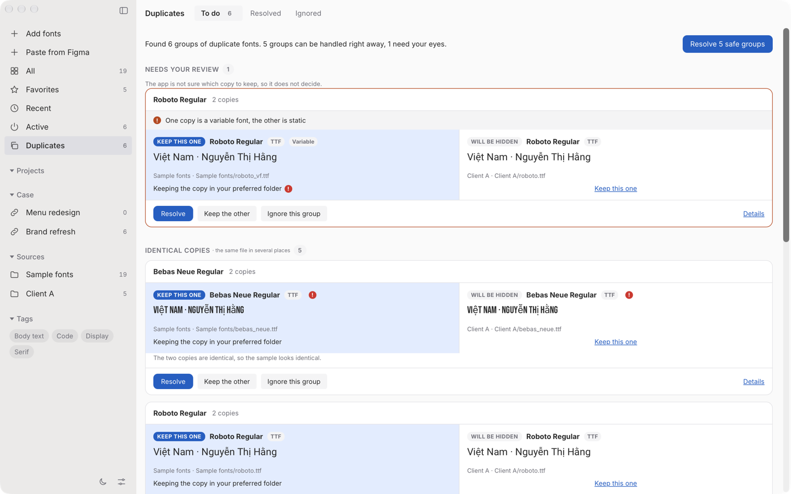
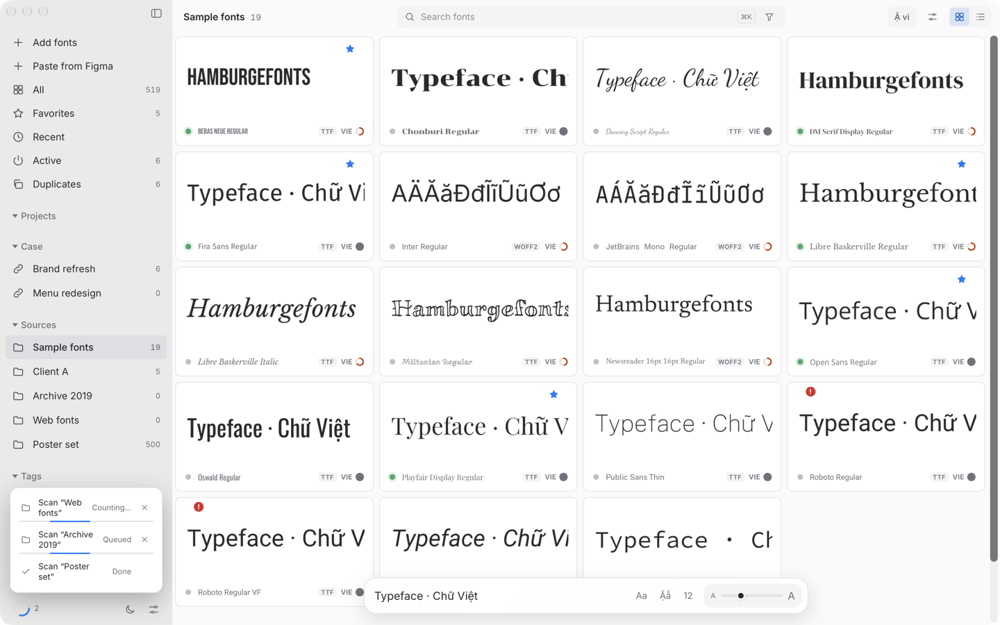
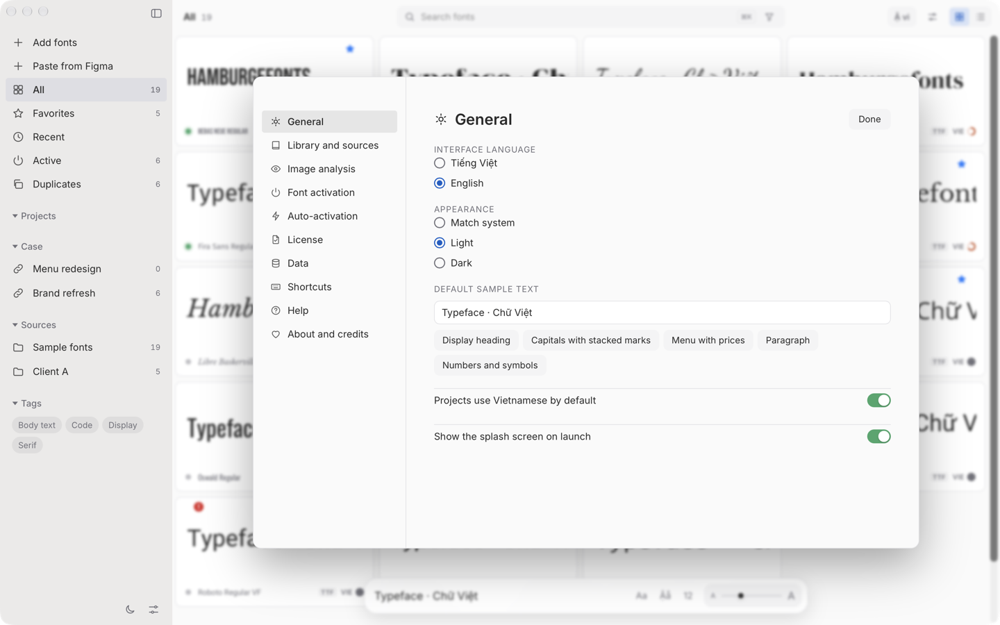

# Font Atlas

**A font manager for graphic designers, art directors and layout artists, built on type anatomy.**
macOS app (Apple silicon). Interface in English and Vietnamese.

Font Atlas measures every font in your library: x-height, contrast, width, aperture, language coverage and more. It uses those numbers to help you find, compare, pair and turn on fonts. It explains *why* two fonts work together instead of scoring them, and the creative call stays with you.



> **Status:** `0.5.0` beta. Builds are signed ad hoc. Pre-releases are on the [Releases](https://github.com/vietx2811/FontAtlas/releases) page.

---

## Features

### Library
- Add any number of font folders, local or on a cloud drive: iCloud, OneDrive, Google Drive, Dropbox, Box.
  - Files that are still only in the cloud are never downloaded just to scan them.
  - The app watches folders and rescans once a sync has settled, not on every file.
- Grid and list views, group by family, sort by name, date added, weight or release year.
- Favorites, Recent, Projects and Tags. Drag fonts onto the sidebar to file them.
- **Paste from Figma:** copy a selection with the Font Atlas Figma plugin and the app finds the fonts it uses.
- **Organized Library mode** (optional): copies fonts into a tidy `Class / Family / files` folder. Your originals are never moved.



### Search and classification
- **Advanced search:** 18 measured axes in 6 groups, each with a histogram of your library, plus weight and width class. Variable fonts match when their axes cover the range.
- **Language coverage** from Hyperglot data, with a dedicated Vietnamese check.
- **10 classes** (Serif, Slab, Sans, Mono, Script, Handwriting, Display…) with subclasses such as garalde, didone, grotesque, geometric and humanist.
  - Hybrid fonts show their secondary class.
  - The app leaves a label empty rather than guess.
- **Image analysis** (optional, on device): a SigLIP 2 model compares letter shapes so *Similar* matches what the eye sees. Measurements still work without it.
- Every typographic term has a tooltip, illustrated where possible.



### Pairing Desk
- A **Case** is a job, for example a menu, a brand or a poster.
  - Each Case holds roles (Display, Heading, Body, Caption…) and several Combos.
- Suggestions for each role come from 5 sources: pinned fonts, similar fonts, fonts that fit the role, recently viewed fonts, and the whole library.
- **Role fit** is *Good*, *OK* or *Weak*, always with the reason, never a score.
- Pairing styles: serif + sans contrast, same superfamily, same structure, same period, display + neutral.
- Compare modes: compare fonts side by side, or compare Combos as small specimen pages, including Vietnamese coverage.



### Activation
- Turn fonts on without installing them into the system, either for this session or kept on.
- The **Active** screen shows why each font is on: by hand, Case, collection, app, or auto.
- When another app already has a font with the same name on, the app explains the conflict.
  - You can replace that copy with the one in Font Atlas and restore it later.
  - System fonts and the Fonts folders are never touched.
- Variable fonts with the same name as a static family: you choose VF, static or both, once.



### Auto-activation
| App | How |
|---|---|
| Photoshop, After Effects and other macOS apps | Answers the system's font requests. |
| Illustrator | A small background panel, signed on your Mac. |
| InDesign, InCopy | A startup script. |
| Any app, for example Affinity | **Open with app:** a Case turns its fonts on when the chosen app opens. |

Installing or removing a panel or script is done from Settings. Each install first shows exactly what will be written. Removing it only deletes Font Atlas's own files.

### Duplicates
- Plain-language groups: exact copies, older and newer versions, same font in another format.
- Each group shows a preview of the two copies side by side and a suggestion of which to keep.
- Resolving hides the extra copy by default. Moving it to the Trash is optional and asks per file.
- Favorites, tags, Cases and pairs move to the copy you keep. Every resolve can be undone.



### Background tasks
Scans, cloud downloads, imports, duplicate resolving and organizing run in the background.
- A compact tray next to Settings shows progress and lets you cancel.
- It is hidden when nothing is running.
- Cancelling never leaves a half-copied file. Finished work stays and can still be undone.





---

## Install

1. Download the latest `Font Atlas_<version>_aarch64.dmg` from [Releases](https://github.com/vietx2811/FontAtlas/releases).
2. Open the DMG and drag **Font Atlas** to Applications, or run `Cài Font Atlas.command`.

Requirements:
- macOS on Apple silicon.
- Auto-activation needs the matching Adobe or Affinity app.
- Image analysis downloads its model on first use.

Your data stays on your Mac. Before an update changes the database, the app makes a backup in the `backups` folder.

## Build from source

```bash
cd UX
npm ci
npm run tauri:dev        # debug build (needs Rust + tauri-cli)
```

To keep a debug build away from your real library, give it its own data folder:

```bash
FONTATLAS_DATA_DIR=$(mktemp -d) npm run tauri:dev
```

| Layer | Stack |
|---|---|
| App shell | Tauri 2 |
| UI | React 19, TypeScript, Vite |
| Core | Rust workspace in `UX/src-tauri/crates` |
| Database | SQLite |
| Image model | SigLIP 2 via candle, on device |

Core crates:

| Crate | Job |
|---|---|
| `fontatlas-core` | Parsing and measuring fonts |
| `fontatlas-index` | Indexing and search |
| `fontatlas-store` | The SQLite database |
| `fontatlas-activate` | Turning fonts on and off (CoreText) |
| `fontatlas-fontreq` | Answering the system's font requests |
| `fontatlas-broker` | Local service the Adobe panel and script talk to |
| `fontatlas-cep` | Illustrator panel |
| `fontatlas-indesign` | InDesign startup script |
| `fontatlas-embed` | Image embeddings |
| `fontatlas-preview` | Specimen previews |

Tests:

```bash
cd UX && npx tsc --noEmit && npx vitest run
cd UX/src-tauri && cargo test --workspace && cargo clippy --workspace --all-targets -- -D warnings
```

`tools/ci/local_ci.sh` runs every check above plus native QA on a debug build.

## Licenses and credits

- Font Atlas is a tool. It does not check or enforce font licenses: you are responsible for how you use your fonts.
- Third-party components are listed in `UX/src-tauri/resources/THIRD-PARTY-NOTICES.txt` and in the app under *Settings → About and credits*.
- The fonts used in tests and screenshots are open-source (OFL or Apache).

---

## Tiếng Việt

Font Atlas là app quản lý font cho designer, AD và người dàn trang, dựa trên giải phẫu chữ.
- **Thư viện:** quét thư mục local và mọi loại ổ cloud.
- **Tìm và phân loại:** tìm theo số đo, phân loại 10 class, kiểm độ phủ tiếng Việt.
- **Ghép font:** Pairing Desk chia theo Case và vai, có lý do vì sao hợp thay vì chấm điểm.
- **Bật font:** bật không cần cài vào hệ thống, tự bật trong Adobe và Affinity.
- **Font trùng:** gộp an toàn, hoàn tác được.
- **Tác vụ nền:** có khay theo dõi tiến độ, huỷ được.

Bản cài ở trang [Releases](https://github.com/vietx2811/FontAtlas/releases).
